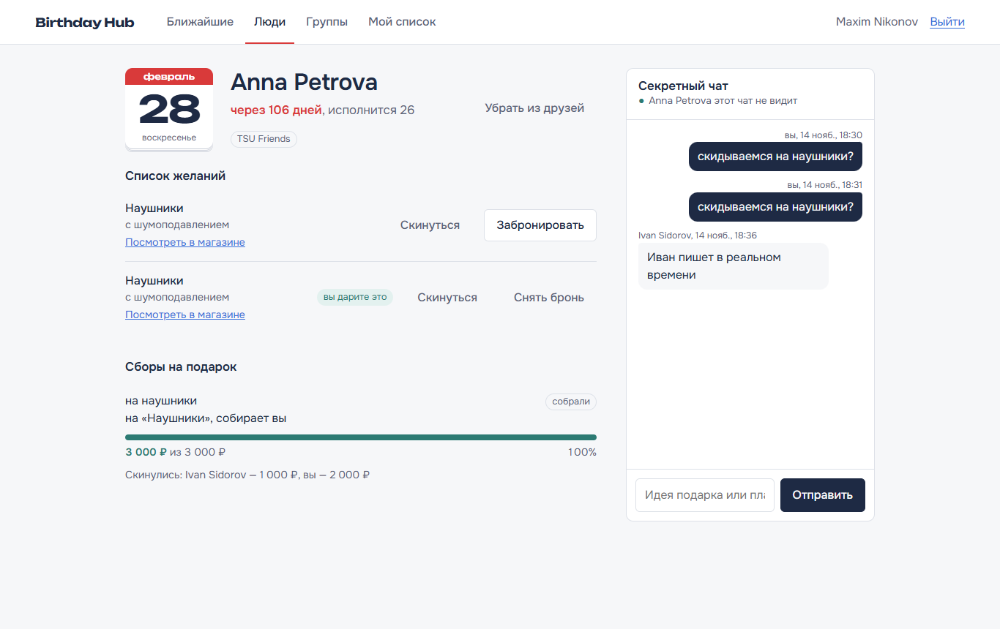
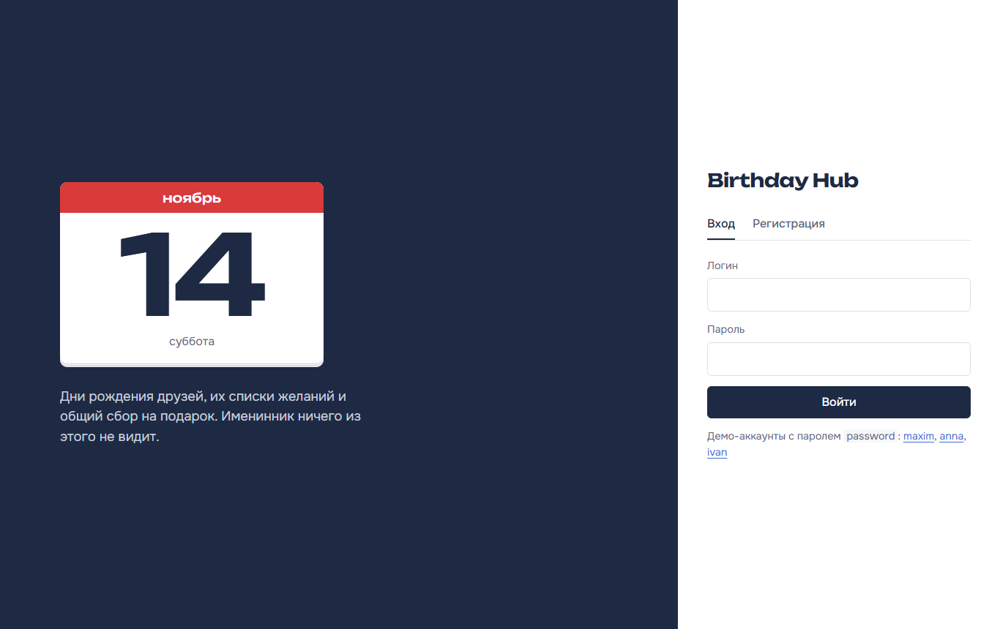
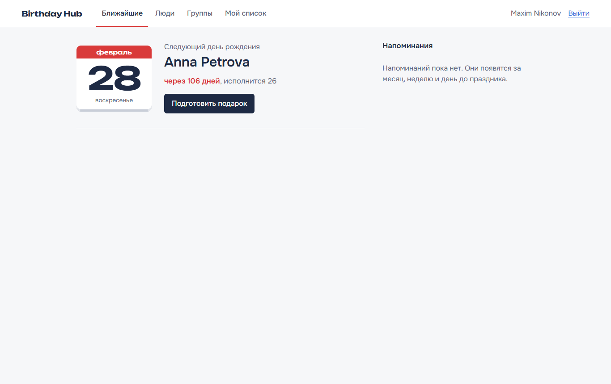
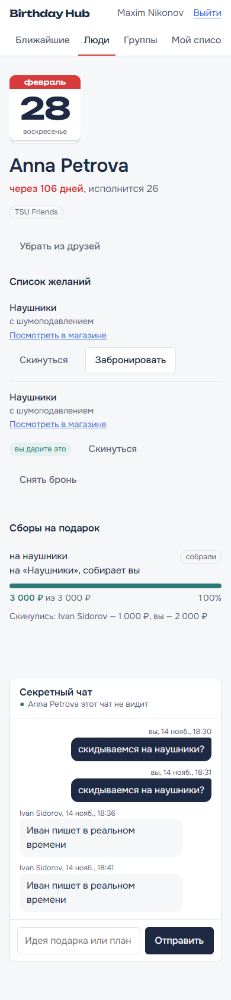
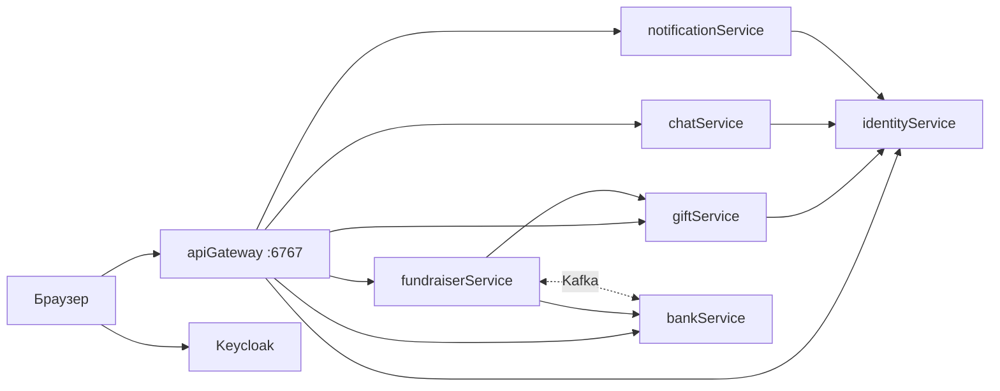

# Birthday Hub

Сервис, чтобы не забывать про дни рождения друзей и готовить подарок вместе: списки желаний, бронь подарка, общий сбор денег и секретный чат, который именинник не видит.

Проект сделан на хакатоне командой из двух человек, потом доработан: исправлены ошибки доступа, добавлены сбор денег через Kafka, новый интерфейс и тесты.



## Что умеет

- **Ближайшие дни рождения.** Друзья и участники ваших групп отсортированы по дате, считаются годы и 29 февраля.
- **Напоминания** за 30, 7 и 1 день и в сам день рождения. Создаются раз в сутки по расписанию и при входе в приложение.
- **Список желаний.** Друзья бронируют подарок, чтобы не подарить одно и то же. Владелец списка не видит, что и кем забронировано.
- **Сбор денег.** Любой друг открывает сбор на конкретный подарок, остальные скидываются через демо-банк. Прогресс обновляется через Kafka.
- **Секретный чат** про подарок. Доступен друзьям и участникам общих групп, сообщения приходят по WebSocket. Именинник в свой чат попасть не может.
- **Группы** для учёбы, работы или семьи: вступить, выйти, получать напоминания обо всех участниках.

| Вход | Ближайшие | Телефон |
|---|---|---|
|  |  |  |

## Как запустить

Нужны Docker Desktop и JDK 21+ (Gradle скачается сам).

```powershell
git clone https://github.com/nmaksimka/HB-system.git
cd HB-system
Copy-Item .env.example .env
.\run.ps1
```

`run.ps1` собирает и тестирует все сервисы, затем поднимает их в Docker. Первый запуск занимает несколько минут. Когда всё стартует, откройте http://localhost:6767.

Демо-аккаунты (пароль `password`):

| Логин | Пользователь |
|---|---|
| `maxim` | Maxim Nikonov |
| `anna` | Anna Petrova |
| `ivan` | Ivan Sidorov |

Все трое состоят в группе «TSU Friends». Можно и зарегистрировать новый аккаунт на экране входа.

Если порт 8080 уже занят, поменяйте в `.env` две строки: `KEYCLOAK_PORT=8081` и `OAUTH2_ISSUER_URI=http://localhost:8081/realms/birthday-hub`.

Остановить: `docker compose down`. Удалить ещё и данные: `docker compose down -v`.

## Архитектура



| Сервис | Порт | За что отвечает |
|---|---:|---|
| `apiGateway` | 6767 | единая точка входа, проверка JWT, маршруты, раздаёт фронтенд |
| `identityService` | 6701 | пользователи, группы, подписки, регистрация в Keycloak |
| `giftService` | 6702 | списки желаний и бронь подарков |
| `chatService` | 6703 | секретный чат, REST и WebSocket (STOMP) |
| `notificationService` | 6704 | напоминания и ежедневный шедулер |
| `fundraiserService` | 6705 | сборы денег на подарок |
| `bankService` | 6706 | демо-банк: приём платежей |

Наружу открыты только gateway и Keycloak. Сервисы и базы видны лишь внутри Docker-сети. У каждого сервиса своя база PostgreSQL и свои миграции Flyway; Hibernate работает в режиме `validate`.

Подробно про потоки данных и решения: [docs/architecture.md](docs/architecture.md).

## Стек

Java 21, Spring Boot 4, Spring Cloud Gateway (WebFlux), Spring MVC, Spring Data JPA, Spring Security OAuth2 Resource Server, Keycloak 26, PostgreSQL 17, Flyway, Apache Kafka 3.9, OpenFeign + Resilience4j, WebSocket/STOMP, Docker Compose, JUnit 5, Mockito, AssertJ. Фронтенд без сборщика: HTML, CSS и JavaScript.

## Безопасность

- Пользователь всегда берётся из JWT, а не из тела запроса.
- Именинник не видит свой чат, сборы на свои подарки и чужие брони в своём списке.
- Чат открыт только друзьям и участникам общих групп; та же проверка срабатывает при подписке на WebSocket.
- Внутренние эндпоинты `/internal/**` требуют служебный токен `X-Internal-Token` и закрыты на gateway.
- Ссылки в списке желаний принимаются только с `http://` и `https://`.

## API

Все запросы идут через `http://localhost:6767` с заголовком `Authorization: Bearer <token>`.

```http
POST   /api/auth/register                          регистрация
GET    /api/me                                     мой профиль
GET    /api/me/upcoming                            ближайшие дни рождения
GET    /api/users                                  все пользователи
GET    /api/users/{id}/card                        карточка человека

GET    /api/groups                                 группы с участниками
POST   /api/groups                                 создать группу
PUT    /api/groups/{id}/members/me                 вступить
DELETE /api/groups/{id}/members/me                 выйти

POST   /api/subscriptions/users/{id}               добавить в друзья
POST   /api/subscriptions/groups/{id}              напоминать обо всех в группе
GET    /api/subscriptions                          мои подписки

GET    /api/me/wishes                              мой список
POST   /api/me/wishes                              добавить желание
GET    /api/users/{id}/wishes                      список друга
PUT    /api/users/{id}/wishes/{wishId}/reservation забронировать
DELETE /api/users/{id}/wishes/{wishId}/reservation снять бронь

POST   /api/fundraisers                            открыть сбор
GET    /api/users/{id}/fundraisers                 сборы на подарки человека
GET    /api/fundraisers/{id}                       сбор и взносы
POST   /api/fundraisers/{id}/cancel                отменить сбор
POST   /api/bank/collections/{id}/payments         скинуться

GET    /api/chat/users/{id}/messages               история чата
POST   /api/chat/users/{id}/messages               написать в чат
WS     /ws  →  SUBSCRIBE /topic/chat/{id}          новые сообщения

POST   /api/notifications/refresh                  пересчитать напоминания
PUT    /api/notifications/{id}/read                прочитать
PUT    /api/notifications/read-all                 прочитать все
```

Ошибки возвращаются в формате `ProblemDetail`: 400 — неверные данные, 403 — нет прав, 404 — не найдено, 409 — конфликт (подарок уже забронирован, логин занят, сбор уже идёт), 503 — недоступен соседний сервис.

## Тесты

```powershell
.\gradlew.bat test
```

Unit-тесты на бизнес-логику всех сервисов: расчёт дней рождения и 29 февраля, права доступа к чату и сборам, бронь подарков, пороги напоминаний, идемпотентность платежей и обработки событий Kafka, возврат платежа в закрытый сбор.

## Ветки

- `main` — стабильная версия.
- `develop` — разработка, сюда сливаются фича-ветки.
- `feat/ui` — интерфейс.
