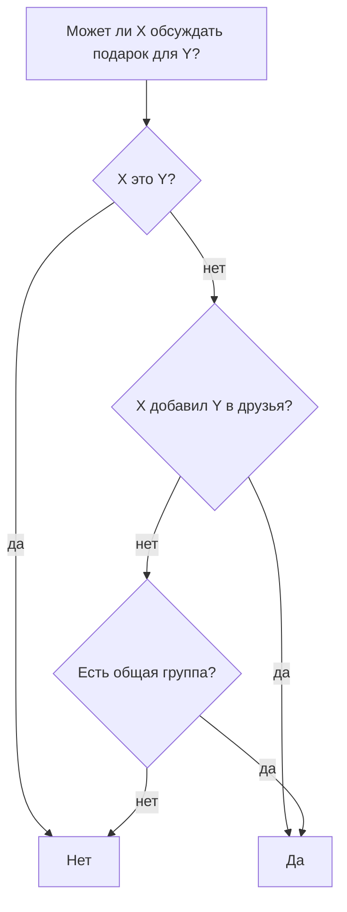
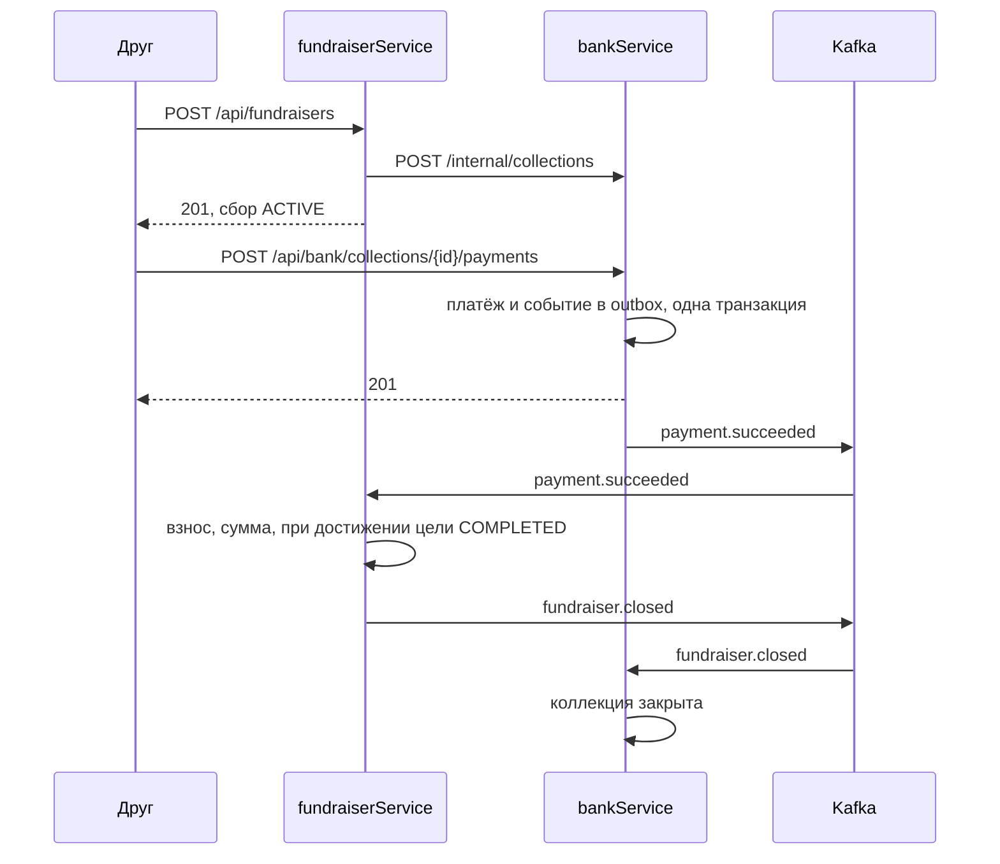

# Архитектура Birthday Hub

## Вход и токены

Пользователь логинится на странице приложения. Браузер получает адрес Keycloak из `GET /auth/config` на gateway и запрашивает у Keycloak access и refresh токены. Дальше каждый запрос к `/api/**` идёт с `Authorization: Bearer`, gateway проверяет подпись JWT и проксирует запрос в нужный сервис. Сервисы ещё раз проверяют токен как resource server и берут id пользователя из claim `user_id`, а если его нет — из `sub`.

Регистрация идёт через `identityService`: он создаёт пользователя в Keycloak через admin API и сразу заводит профиль. Если профиль сохранить не удалось, пользователь в Keycloak удаляется, чтобы не оставалось аккаунта без профиля.

## Кто кого может видеть

Проверку делает `identityService` (`/internal/users/{subject}/discussions/{viewer}`). `chatService` вызывает её при чтении и отправке сообщений и при STOMP-подписке на `/topic/chat/{id}`. Сообщения отправляются только через REST, а WebSocket нужен для доставки новых сообщений.

## Бронь подарка

Две брони одного подарка одновременно ловятся оптимистической блокировкой: у `Wish` есть поле `@Version`. Второй запрос получает `ObjectOptimisticLockingFailureException`, который превращается в 409. Владелец списка получает свои желания без признака брони.

## Сбор денег

Что здесь важно:

- **Transactional outbox.** Платёж и событие сохраняются в одной транзакции. Отдельный `OutboxRelay` раз в секунду отправляет неотправленные события в Kafka. Если Kafka недоступна, событие останется в таблице и уйдёт позже.
- **Идемпотентность платежа.** Клиент передаёт `idempotencyKey`. Повторный запрос с тем же ключом возвращает уже созданный платёж, а не списывает деньги второй раз.
- **Идемпотентность обработки событий.** Kafka гарантирует доставку как минимум один раз, поэтому каждый потребитель хранит `processed_events` и пропускает событие, которое уже видел.
- **Компенсация.** Если платёж дошёл до сбора, который уже отменён или завершён, сбор публикует `payment.rejected`, и банк помечает платёж возвращённым. Деньги не теряются молча.
- **Нет переплаты.** Банк блокирует строку коллекции (`PESSIMISTIC_WRITE`) и не принимает сумму больше остатка.
- **Порядок событий.** Ключ сообщения в Kafka — id сбора, поэтому события одного сбора попадают в одну партицию и обрабатываются по порядку.

## Напоминания

`notificationService` раз в сутки берёт у `identityService` всех подписчиков и для каждого — ближайшие дни рождения на 30 дней вперёд. Для каждого человека выбирается ближайший порог из 30, 7, 1 и 0 дней. Запись вставляется через `INSERT ... ON CONFLICT DO NOTHING`, поэтому параллельные обновления не падают на уникальном ключе.

## Межсервисные вызовы

Сервисы общаются через OpenFeign с таймаутами и circuit breaker. Внутренние эндпоинты требуют заголовок `X-Internal-Token`, его добавляет `RequestInterceptor`. Если соседний сервис недоступен, клиент получает 503 с понятным сообщением.
