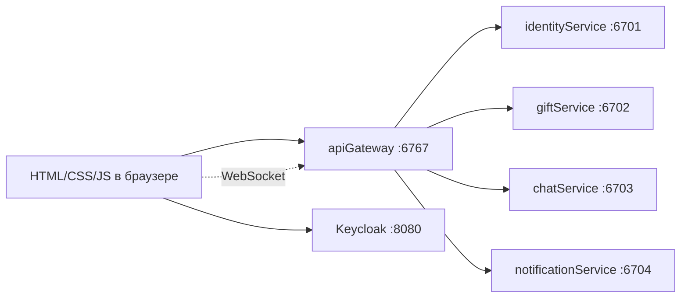

# Как фронтенд соединяется с бэкендом

Фронтенд Birthday Hub находится в `apiGateway/src/main/resources/static` и состоит из трех файлов:

- `index.html` - разметка экранов входа, обзора, друзей, групп и желаний.
- `styles.css` - внешний вид и адаптивная верстка.
- `app.js` - авторизация, состояние экрана и HTTP/WebSocket-вызовы.

## Общая схема

Пользователь открывает сайт по адресу `http://localhost:6767`. Статические файлы отдает `apiGateway`.
Все данные фронтенд получает тоже через gateway, а не напрямую из микросервисов.

## Авторизация

Пользователь больше не вставляет токен вручную.

1. На экране входа пользователь вводит логин и пароль или нажимает кнопку входа через Keycloak.
2. `app.js` получает access token у Keycloak в фоне.
3. Токен сохраняется в `localStorage`.
4. Каждый запрос к `/api/**` получает заголовок `Authorization: Bearer <token>`.
5. Если access token истекает, `app.js` пробует обновить его через refresh token.

Для нового аккаунта после регистрации фронтенд вызывает `POST /api/me/profile`. Так создается профиль Birthday Hub с тем же UUID, который пришел из JWT.

## Основные вызовы API

- `GET /api/me` - текущий пользователь.
- `POST /api/me/profile` - создание профиля после первого входа.
- `GET /api/users` - список людей.
- `GET /api/users/{id}/card` - карточка друга с группами и желаниями.
- `GET /api/groups`, `POST /api/groups` - список и создание групп.
- `PUT /api/groups/{groupId}/members/me` - вступить в группу.
- `POST /api/subscriptions/users/{targetUserId}` - подписка на друга.
- `POST /api/subscriptions/groups/{groupId}` - подписка на группу.
- `GET /api/me/wishes`, `POST /api/me/wishes`, `DELETE /api/me/wishes/{wishId}` - wishlist текущего пользователя.
- `POST /api/notifications/refresh?days=30` - пересчитать ближайшие напоминания.
- `PUT /api/notifications/{reminderId}/read` - отметить напоминание прочитанным.
- `GET /api/chat/users/{subjectUserId}/messages` - история секретного чата.
- `POST /api/chat/users/{subjectUserId}/messages` - отправка сообщения через REST.
- `/ws` - WebSocket/STOMP для real-time сообщений.

Главная идея: браузер знает только gateway и Keycloak. Gateway уже решает, в какой микросервис отправить конкретный `/api` или `/ws` запрос.
