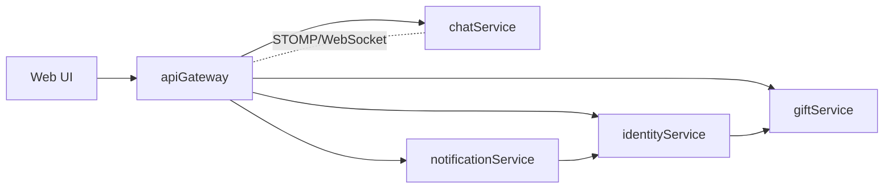

# UI flow и архитектура Birthday Hub

## UX flow приложения

Сайт открывается на gateway (`http://localhost:6967`) и ведет пользователя по основному сценарию из ТЗ:

1. Пользователь выбирает себя в боковой панели.
2. На вкладке "Друзья" открывает карточку человека: дата рождения, группы, wish-list и секретный чат.
3. Подписывается на конкретного друга или на группу.
4. На вкладке "Обзор" обновляет напоминания за выбранный период, например за 30 дней.
5. На вкладке "Мои желания" публикует собственные подарки, которые увидят другие.
6. На вкладке "Группы" создает общую группу или вступает в уже существующую.
7. В карточке друга обсуждает подарок в чате. Если текущий пользователь совпадает с именинником, чат блокируется, потому что это секретное обсуждение без участия самого друга.

Основная UX-идея: не заставлять пользователя ходить по разным техническим сервисам. Вся работа идет через одну страницу: слева контекст "кто я", справа рабочие разделы. Карточка друга является центральной точкой подготовки поздравления.

## Экранная структура

- **Обзор**: метрики, ближайшие напоминания, короткий сценарий действий.
- **Друзья**: список пользователей с поиском и расчетом ближайшего дня рождения.
- **Карточка друга**: дата рождения, группы, wish-list, подписка на друга, секретный чат.
- **Группы**: создание группы, вступление текущего пользователя, подписка на группу.
- **Мои желания**: публикация и удаление wish-list текущего пользователя.

## Архитектура бэкенда

Проект сделан как микросервисная система:

- `apiGateway` - единая входная точка для фронтенда, REST API и WebSocket.
- `identityService` - пользователи, группы, участники групп, подписки.
- `giftService` - желания пользователей.
- `chatService` - история сообщений и real-time чат.
- `notificationService` - напоминания о ближайших днях рождения.

У каждого stateful-сервиса своя PostgreSQL-база и свои Flyway-миграции. Это важная граница: сервисы не лезут напрямую в чужие таблицы, а общаются через HTTP-клиенты и gateway.

## Связи сервисов

- UI ходит только в gateway.
- Gateway маршрутизирует `/api/users`, `/api/groups`, `/api/subscriptions` в identity.
- Gateway маршрутизирует `/api/users/{id}/wishes` в gift.
- Gateway маршрутизирует `/api/chat/**` и `/ws` в chat.
- Gateway маршрутизирует `/api/notifications/**` в notification.
- `identityService` вызывает `giftService`, чтобы собрать карточку друга вместе с желаниями.
- `notificationService` вызывает `identityService`, чтобы получить ближайшие дни рождения по подпискам.

## Сложные моменты бэкенда

1. **Карточка друга собирается из нескольких источников.** Identity знает пользователя и группы, но wish-list находится в giftService. Поэтому `IdentityService.card()` делает межсервисный вызов через `GiftClient`.

2. **Напоминания зависят от подписок.** Пользователь может подписаться на конкретного друга или на группу. Для групп identity разворачивает подписку в список участников, считает ближайшие дни рождения и отдает их notificationService.

3. **Дата 29 февраля обработана отдельно.** В сервисах есть логика, которая переносит день рождения на 28 февраля в невисокосный год.

4. **Секретный чат защищен бизнес-правилом.** `ChatService` запрещает имениннику читать и писать в чат, где обсуждают его подарок.

5. **Сервисы изолированы по данным.** Нет общей JPA-модели на все приложение. Это усложняет сбор составных экранов, но делает границы сервисов понятнее.

6. **Ошибки возвращаются как `ProblemDetail`.** Это удобно для фронтенда: можно показывать пользователю `detail` или `title`.

## Зачем нужен WebFlux

WebFlux используется в `apiGateway`, потому что Spring Cloud Gateway построен на реактивной модели. Gateway не выполняет тяжелую бизнес-логику и не должен держать поток на каждый долгий запрос. Его задача - принимать много входящих соединений, проксировать HTTP/WebSocket дальше и эффективно ждать ответы сервисов.

Практически это дает:

- неблокирующую маршрутизацию запросов;
- нормальную поддержку WebSocket-проксирования;
- удобные gateway-фильтры, например `CorrelationIdFilter`;
- меньшую стоимость большого числа одновременных соединений.

Остальные сервисы используют обычный Spring MVC (`spring-boot-starter-web`), потому что там много классической CRUD-логики, JPA и транзакций. Это нормальная комбинация: реактивный gateway снаружи, синхронные бизнес-сервисы внутри.

## Технологии проекта

- **Java 21** - современный LTS Java-рантайм.
- **Spring Boot 4** - основа приложений, автоконфигурация, embedded server, actuator.
- **Spring Cloud Gateway WebFlux** - единая точка входа, маршрутизация, CORS, WebSocket-прокси.
- **Spring MVC** - REST-контроллеры внутренних сервисов.
- **Spring Data JPA / Hibernate** - работа с PostgreSQL через entity и repository.
- **PostgreSQL** - отдельные базы данных для сервисов.
- **Flyway** - версионирование схемы БД через миграции.
- **OpenFeign** - декларативные HTTP-клиенты между сервисами.
- **Resilience4j** - circuit breaker для межсервисных вызовов.
- **WebSocket/STOMP** - real-time чат без ручного обновления страницы.
- **Spring Validation** - проверка входных DTO.
- **Springdoc OpenAPI** - Swagger UI для ручной проверки API.
- **Actuator, Micrometer, Prometheus registry** - health checks, метрики и наблюдаемость.
- **Docker Compose** - запуск всей системы с базами и сервисами.
- **Gradle Kotlin DSL** - сборка multi-module проекта.

## Как UI связан с API

- `GET /api/users`, `POST /api/users` - список и создание пользователей.
- `GET /api/users/{id}/card` - карточка друга.
- `POST /api/subscriptions` - подписка на друга или группу.
- `POST /api/notifications/users/{userId}/refresh?days=30` - создание и получение напоминаний.
- `PUT /api/notifications/users/{userId}/{reminderId}/read` - отметить напоминание прочитанным.
- `GET /api/users/{id}/wishes`, `POST /api/users/{id}/wishes`, `DELETE /api/users/{id}/wishes/{wishId}` - wish-list.
- `GET /api/chat/users/{subjectUserId}/messages?viewerId={viewerId}` - история чата.
- `ws://localhost:6967/ws`, `/app/chat/{subjectUserId}`, `/topic/chat/{subjectUserId}` - real-time сообщения.
